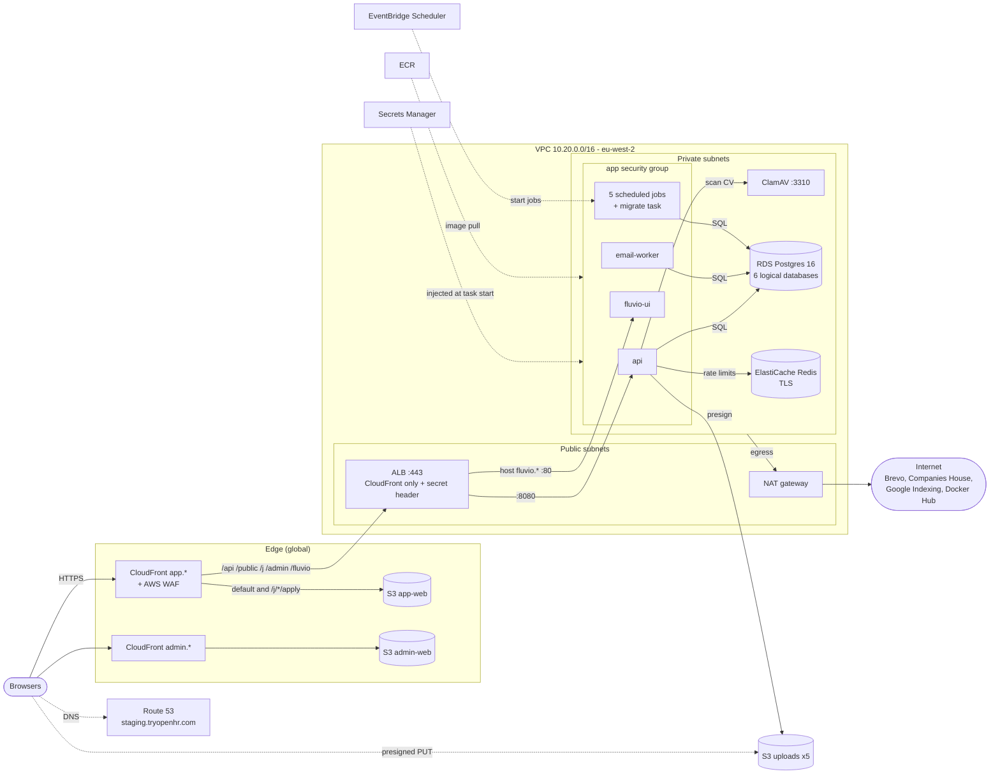
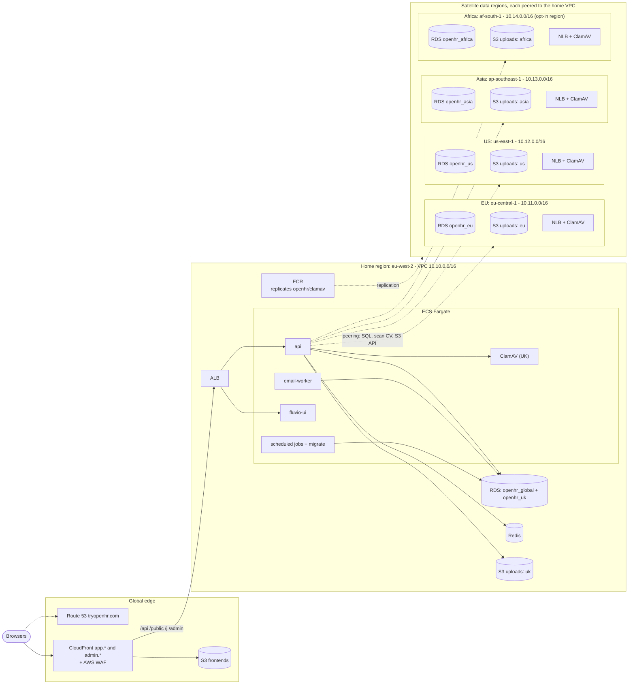

# OpenHR AWS architecture

Mermaid diagrams of what `envs/staging` and `envs/production` create. GitHub renders them in the browser.
Solid arrows follow a request or a query; dashed arrows are DNS, control-plane calls, replication or peering.

## Staging (single region, single database instance)

Staging is stopped and started by hand with `scripts/staging-power.sh` (RDS and services). The NAT gateway, ALB, Redis and WAF keep running.

## Production (home region plus four peered data regions)

The API, workers, Redis and edge run only in the home region. The `global` and `uk` databases share one instance there.
Every other data region has its own VPC, Postgres, uploads bucket and ClamAV scanner, reached over VPC peering.

Satellite regions reach the internet through a small NAT (fck-nat instance; a managed gateway in Africa) for ClamAV
signature updates. A CV is stored and scanned in the job's own region, but the single API stack in the home region still
handles the bytes in transit, as it does for all application data. That follows from the one-API-stack topology and
should be stated to counsel when residency commitments are written.
